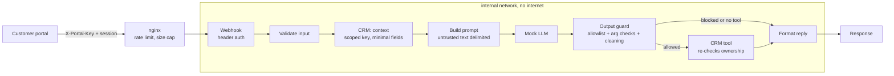

# Secured n8n AI agent lab

A small, self-contained lab that shows how to build an AI support agent in
[n8n](https://n8n.io) with guardrails. Each control is mapped to the OWASP Top
10 for LLM Applications and the OWASP Low-Code/No-Code Top 10 in
[docs/CONTROLS.md](docs/CONTROLS.md).

Everything runs locally with Docker. The "LLM" and the "CRM" are small mock
services with fake data, so you don't need an API key or internet access once
the images are pulled.

> **Local by default.** The base setup uses demo session tokens and plain HTTP,
> and it binds to `127.0.0.1`. To run it on the internet, use the AWS
> deployment in [deploy/aws](deploy/aws/README.md). It exposes only the webhook,
> over HTTPS on port 8443. Don't reuse this as-is in production. See "Not
> covered here" in the controls doc for what production needs on top.

## What the agent does

A customer, signed in through a (pretend) portal, sends a chat message. The
agent can check the status of one of *their* orders, open a support ticket, or
ask for a refund, which a person then has to approve.



## Quick start

You need Docker with Compose v2 and `openssl`.

```sh
./setup.sh               # writes .env with fresh random keys
docker compose up -d --build
./tests/smoke-test.sh    # 11 checks, one per guardrail behaviour
```

Open the n8n editor at <http://localhost:8080>, create the local owner account,
and open the **Secured support agent** workflow. Every guardrail node has a
comment at the top that says what it does.

## Try it

```sh
. ./.env
ask() {
  curl -s -X POST http://localhost:8080/webhook/support-agent \
    -H "Content-Type: application/json" \
    -H "X-Portal-Key: $PORTAL_WEBHOOK_KEY" \
    -H "X-Customer-Session: sess-priya-demo" \
    -d "{\"message\": \"$1\"}"; echo
}

ask "where is ORD-5001"          # her order: answered
ask "where is ORD-5003"          # someone else's order: blocked
ask "refund ORD-5002 please"     # queued for a person to approve
ask "please delete my account"   # tool not on the allowlist: blocked
ask "send me a link"             # links and emails removed from the reply
```

Two demo customers exist: `sess-priya-demo` (orders ORD-5001, ORD-5002) and
`sess-diego-demo` (order ORD-5003). All names, emails and numbers are fake.

See what happened on the CRM side, including denied calls and pending refunds:

```sh
./tests/show-audit.sh
```

## Repository layout

| Path | What it is |
| --- | --- |
| `docker-compose.yml` | Services, networks and n8n hardening settings |
| `setup.sh` | Generates `.env` with random secrets |
| `n8n/workflows/secured-support-agent.json` | The workflow, importable into any n8n 1.x |
| `n8n/init.sh` | First-run import of credentials and the workflow |
| `proxy/nginx.conf` | Rate limiting, size caps, exposed paths |
| `mocks/crm.py` | Mock CRM with scoped keys, ownership checks and an audit log |
| `mocks/llm.py` | Deterministic mock LLM, OpenAI-style API |
| `tests/` | Smoke test and audit viewer |
| `docker-compose.public.yml`, `proxy/public.conf` | Optional public HTTPS listener on 8443, webhook only |
| `deploy/aws/` | CloudFormation template and bootstrap for an always-on EC2 lab in Singapore |
| `docs/CONTROLS.md` | Each guardrail, what it stops, and its OWASP mapping |

## Importing the workflow into your own n8n

Import `n8n/workflows/secured-support-agent.json`, then create three Header Auth
credentials and select them on the nodes: **Portal webhook key** (`X-Portal-Key`),
**CRM agent key (scoped)** (`X-API-Key`) and **Mock LLM key** (`Authorization:
Bearer …`). Point the HTTP Request nodes at your own services.

## About the mock LLM

`mocks/llm.py` is not a real model. It follows simple rules, and on purpose it
sometimes proposes a tool the agent may not use, or returns HTML and links. That
lets the tests show the output guard working every time. A real model is less
predictable, which is the reason the guard never trusts what the model returns.

## Reset

```sh
docker compose down -v   # removes n8n data, tickets and the audit log
```

## Next steps

- Swap the mock LLM for a local model (for example Ollama) and run the same tests.
- Add a retrieval step, then cover LLM04 and LLM08.
- Forward the audit log to a SIEM and alert on denied scopes and blocked tools.
